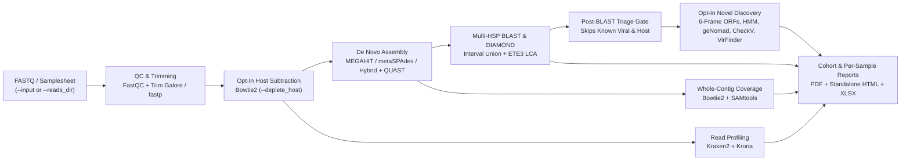

# MetaNextViro

<p align="center">
  <picture>
    <source media="(prefers-color-scheme: dark)" srcset="assets/logo_dark.svg">
    <source media="(prefers-color-scheme: light)" srcset="logo.svg">
    
  </picture>
</p>

<p align="center">
  <a href="https://github.com/navduhan/metanextviro/releases"></a>
  <a href="https://github.com/navduhan/metanextviro/actions/workflows/ci.yml"></a>
  <a href="LICENSE"></a>
  <a href="https://www.nextflow.io/"></a>
  <a href="https://github.com/navduhan/metanextviro/pkgs/container/metanextviro"></a>
</p>

**MetaNextViro** is an open-source Nextflow DSL2 pipeline for reference-guided viral metagenomic surveillance and opt-in divergent virus discovery. It combines read quality control, optional host read subtraction, de novo assembly (MEGAHIT, metaSPAdes, or hybrid), Kraken2 read profiling, coordinate-resolved multi-HSP BLASTN and DIAMOND annotation, whole-contig read coverage, post-BLAST contig triage, identity-calibrated viral discovery, hallmark RdRp phylogenetics, and cohort plus per-sample PDF and HTML reporting.

---

## Workflow Overview



---

## Quick Start

### 1. Prerequisites
- **Nextflow** (`>= 22.10.0`) and **Java** (`17` to `26`)
- One software backend: **Conda / Mamba**, **Docker**, **Singularity**, or **Apptainer**

If Nextflow is not installed yet, create the lightweight launcher environment once:

```bash
conda create -n metanextviro -c conda-forge -c bioconda nextflow openjdk=21
conda activate metanextviro
```

### 2. Pull Once and Run Using the Short Name

```bash
# One-time pull (caches pipeline in ~/.nextflow/assets so `nextflow run metanextviro` works anywhere)
nextflow pull navduhan/metanextviro

# 1. Generate a validated samplesheet.csv from a directory of paired FASTQ files
nextflow run metanextviro \
  --create_samplesheet \
  --reads_dir ./raw_fastqs \
  --samplesheet samplesheet.csv

# 2. Download and index default viral reference databases (~4.0 GB full_viral preset)
nextflow run metanextviro \
  --setup_databases \
  --db_dir ~/.metanextviro/dbs \
  -profile conda

# 3. Routine viral surveillance (from --input samplesheet.csv OR directly from --reads_dir)
nextflow run metanextviro \
  --input samplesheet.csv \
  --outdir results \
  -profile conda

# 4. Divergent virus discovery + VirFinder with putative Order/Family taxonomy
nextflow run metanextviro \
  --input samplesheet.csv \
  --outdir results \
  --deplete_host --host_fasta host_genome.fa \
  --discover_novel_viruses --run_virfinder \
  --run_checkv --run_genomad \
  -profile conda
```

### 3. HPC (SLURM) and Optional `pip` CLI

```bash
# SLURM cluster + Mamba (set --conda_cache_dir on shared storage visible to compute nodes)
nextflow run metanextviro \
  --input samplesheet.csv \
  --outdir results \
  --conda_cache_dir /scratch/$USER/metanextviro_envs \
  --account <slurm_account> \
  -profile slurm,mamba

# SLURM cluster + Singularity / Apptainer (pulls ghcr.io + pinned BioContainers)
nextflow run metanextviro \
  --input samplesheet.csv \
  --outdir results \
  --account <slurm_account> \
  -profile slurm,singularity

# Optional pip CLI launcher (thin wrapper around `nextflow run`)
pip install git+https://github.com/navduhan/metanextviro.git
metanextviro pull
metanextviro --input samplesheet.csv --outdir results -profile conda
```

### Samplesheet Format

Create `samplesheet.csv` automatically with `--create_samplesheet --reads_dir <dir>` (or pass `--reads_dir <dir>` directly to analyze in one step), or provide a CSV/TSV file with either `sample,fastq_1,fastq_2` or `id,reads1,reads2`:

```csv
sample,fastq_1,fastq_2
Avian_Swab_01,/path/to/Avian_Swab_01_R1.fastq.gz,/path/to/Avian_Swab_01_R2.fastq.gz
Swine_Nasal_02,/path/to/Swine_Nasal_02_R1.fastq.gz,/path/to/Swine_Nasal_02_R2.fastq.gz
```

---

## Documentation

Full operational guides, parameter tables, algorithmic details, and a downloadable PDF manual live in [`docs/`](docs/):

| Document | Contents |
| :--- | :--- |
| **[MetaNextViro User Manual (PDF)](docs/MetaNextViro_Documentation.pdf)** | Complete printable reference manual covering installation, walkthroughs, profiles, databases, algorithms, output schemas, and troubleshooting. |
| **[Quick Start & Walkthrough (`docs/quickstart.md`)](docs/quickstart.md)** | Step-by-step setup, FASTQ samplesheet patterns, routine vs. discovery runs, `-params-file` YAML, and `-resume`. |
| **[Usage, Parameters & Profiles (`docs/usage.md`)](docs/usage.md)** | Full CLI parameter reference, tiered Conda environments (`envs/`), `--conda_cache_dir`, Docker/Singularity BioContainers, and SLURM resource labels. |
| **[Reference Databases (`docs/databases.md`)](docs/databases.md)** | `--setup_databases` presets, component inventory, disk footprints, offline HPC staging, and custom database overrides. |
| **[Homology & Novel Discovery (`docs/discovery.md`)](docs/discovery.md)** | Multi-HSP interval union math, whole-contig coverage, post-BLAST triage, 6-frame ORF/DTR/entropy/EVE gates, composite scoring, and ICTV rank calibration. |
| **[Outputs, Schemas & Cleanup (`docs/output.md`)](docs/output.md)** | Output directory layout, column-by-column file dictionaries, cohort/per-sample reports, `--publish_mode`, and safe `bin/cleanup_work.py` cleanup. |
| **[Troubleshooting & FAQ (`docs/troubleshooting.md`)](docs/troubleshooting.md)** | Java 17–26, offline SLURM Conda caching, native Apple Silicon `arm64`, GHCR visibility, Singularity bind mounts, and memory tuning. |

---

## Testing

```bash
# Python unit test suite (35 tests)
python -m unittest discover -s tests -v

# Local end-to-end smoke test (uses synthetic reads and databases in a temporary directory)
python tests/smoke_nextflow.py
```

---

## Key Citations

If you use MetaNextViro, please cite the pipeline repository ([https://github.com/navduhan/metanextviro](https://github.com/navduhan/metanextviro)) and the underlying tools you enable:

- **Nextflow**: Di Tommaso et al., *Nature Biotechnology* 35, 316–319 (2017). [10.1038/nbt.3820](https://doi.org/10.1038/nbt.3820)
- **MEGAHIT**: Li et al., *Bioinformatics* 31, 1674–1676 (2015). [10.1093/bioinformatics/btv033](https://doi.org/10.1093/bioinformatics/btv033)
- **metaSPAdes**: Nurk et al., *Genome Research* 27, 824–834 (2017). [10.1101/gr.213959.116](https://doi.org/10.1101/gr.213959.116)
- **BLAST+**: Camacho et al., *BMC Bioinformatics* 10, 421 (2009). [10.1186/1471-2105-10-421](https://doi.org/10.1186/1471-2105-10-421)
- **DIAMOND**: Buchfink et al., *Nature Methods* 18, 366–368 (2021). [10.1038/s41592-021-01101-x](https://doi.org/10.1038/s41592-021-01101-x)
- **Kraken2**: Wood et al., *Genome Biology* 20, 257 (2019). [10.1186/s13059-019-1891-0](https://doi.org/10.1186/s13059-019-1891-0)
- **Bowtie2**: Langmead & Salzberg, *Nature Methods* 9, 357–359 (2012). [10.1038/nmeth.1923](https://doi.org/10.1038/nmeth.1923)
- **SAMtools**: Danecek et al., *GigaScience* 10, giab008 (2021). [10.1093/gigascience/giab008](https://doi.org/10.1093/gigascience/giab008)
- **CheckV**: Nayfach et al., *Nature Biotechnology* 39, 578–585 (2021). [10.1038/s41587-020-00774-7](https://doi.org/10.1038/s41587-020-00774-7)
- **geNomad**: Camargo et al., *Nature Biotechnology* 42, 1303–1312 (2024). [10.1038/s41587-023-01953-y](https://doi.org/10.1038/s41587-023-01953-y)
- **VirFinder**: Ren et al., *Microbiome* 5, 69 (2017). [10.1186/s40168-017-0283-5](https://doi.org/10.1186/s40168-017-0283-5)
- **VOGDB**: Trgovec-Greif et al., *Viruses* 16, 1191 (2024). [10.3390/v16081191](https://doi.org/10.3390/v16081191)

---

## Support, Author & License

- **Issues & Questions**: Open an issue on [GitHub Issues](https://github.com/navduhan/metanextviro/issues).
- **Author**: Naveen Duhan (`naveen.duhan@sdstate.edu`) — Animal Disease Research and Diagnostic Laboratory, Department of Veterinary and Biomedical Sciences, South Dakota State University.
- **License**: Released under the [MIT License](LICENSE).
