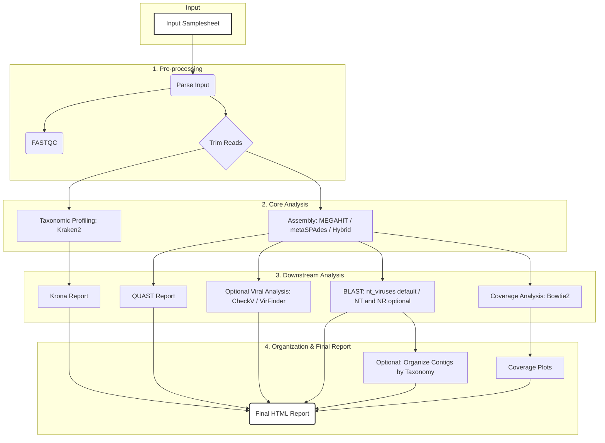

# MetaNextViro: High-Throughput Virus Identification and Metagenomic Analysis Pipeline

<p align="center">
  
</p>

[](https://github.com/navduhan/metanextviro/releases)
[](https://github.com/navduhan/metanextviro/blob/main/LICENSE)
[](https://github.com/navduhan/metanextviro/stargazers)
[](https://github.com/navduhan/metanextviro/network)
[](https://www.nextflow.io/)
[](https://www.docker.com/)
[](https://sylabs.io/singularity/)

<p align="center">
  metagenomics • virology • bioinformatics • nextflow • virus-discovery • metagenomic-assembly • taxonomic-classification • viral-analysis • coverage-analysis • checkv • virfinder • kraken2 • blast • docker • singularity • hpc • slurm
</p>

## Table of Contents

- [Overview](#overview)
- [Pipeline Schema](#pipeline-schema)
- [Quick Start](#quick-start)
- [Features](#features)
- [Key Improvements](#key-improvements)
- [Prerequisites](#prerequisites)
- [Installation](#installation)
- [Running the Pipeline](#running-the-pipeline)
- [Resource Management on SLURM](#resource-management-on-slurm)
- [Pipeline Steps](#pipeline-steps)
- [Output Structure](#output-structure)
- [Key Output Files](#key-output-files)
- [Configuration](#configuration)
- [Docker & Singularity Support](#docker--singularity-support)
- [Citations](#citations)
- [Support](#support)
- [License](#license)
- [Authors](#authors)

## Overview

MetaNextViro is a robust, modular Nextflow pipeline designed primarily for **virus identification and characterization** from metagenomic sequencing data. While it also supports bacterial profiling, its main focus is on the detection, classification, and annotation of viral sequences in complex samples such as environmental, clinical, or animal/human microbiome datasets.

The pipeline integrates state-of-the-art tools for:
- **Quality control and preprocessing** of raw reads (FastQC, fastp, flexbar, trim_galore)
- **Assembly** of metagenomic data (MEGAHIT, metaSPAdes, or hybrid)
- **Taxonomic classification** with Kraken2 and visualization with Krona
- **Optional viral genome completion and quality assessment** (CheckV)
- **Optional viral sequence identification** (VirFinder with custom filtering)
- **BLAST-based annotation** against `nt_viruses` by default, with NT and NR searches available on request
- **Optional organization of contigs** by taxonomy and family
- **Contig-level coverage analysis and visualization** for assembled contigs
- **Comprehensive reporting** with coverage plots and an interactive HTML summary

MetaNextViro is suitable for:
- Discovery of known and novel viruses in metagenomic samples
- Viral diversity and abundance profiling
- Viral genome recovery and annotation
- Comparative virome analysis across samples or conditions
- Integrated viral and bacterial community profiling (optional)

The pipeline is highly portable and reproducible, supporting Conda, Docker, and Singularity environments, and can be run on local workstations, HPC clusters (SLURM), or in the cloud. It is ideal for virome research, outbreak investigations, environmental surveillance, and any project requiring robust viral metagenomics.

## Pipeline Schema




## Quick Start

### Prerequisites
- Nextflow (>=21.10.3)
- Java (>=8)
- Conda, Docker, or Singularity

### Basic Usage
```bash
# Clone the repository
git clone https://github.com/navduhan/metanextviro.git
cd metanextviro

# Run with conda (recommended for first-time users)
nextflow run main.nf \
  --input <your_samplesheet>.csv \
  --outdir <output_directory> \
  --kraken2_db <path_to_your_kraken2_db> \
  -profile conda

# Run with singularity (recommended for HPC)
nextflow run main.nf \
  --input <your_samplesheet>.csv \
  --outdir <output_directory> \
  --kraken2_db <path_to_your_kraken2_db> \
  -profile singularity,slurm
```

### Sample Input Format
Create a `samplesheet.csv` file:
```csv
sample,fastq_1,fastq_2
sample1,/path/to/sample1_R1.fastq.gz,/path/to/sample1_R2.fastq.gz
sample2,/path/to/sample2_R1.fastq.gz,/path/to/sample2_R2.fastq.gz
```

## Features

- Quality control and adapter/quality trimming (FastQC, fastp, flexbar, trim_galore)
- Multiple assembly options (MEGAHIT, metaSPAdes, or hybrid)
- BLAST-based and Kraken2-based taxonomic annotation
- **Flexible BLASTX tool choice** (DIAMOND or traditional BLASTX)
- Optional organization of contigs by taxonomy and family (`--organize_contigs`)
- Optional viral genome completion (CheckV with `--run_checkv`) and classification (VirFinder with `--run_virfinder`)
- **Contig-level coverage analysis** and visualization
- **Modern, Template-Based Final Report** with a clean and interactive design.
- Structured, per-sample output organization

## Key Improvements

### Enhanced VirFinder Analysis
- **Custom R script** (`run_virfinder.R`) for improved control over filtering criteria
- **Dual output format**: Full results and high-confidence filtered results (score ≥ 0.9, p-value ≤ 0.05)

### Improved Coverage Analysis
- **Contig-level coverage calculation** instead of nucleotide-level depth
- **Custom bash script** (`calculate_contig_coverage.sh`) for efficient processing

### Modern Final Report
- **Template-Based**: Report is generated using a Nextflow template, making it robust and easy to modify.
- **Clean Design**: Features a modern, card-based layout for easy navigation.
- **Guaranteed Completion**: Generated only after all pipeline steps are finished.

## Prerequisites

- Nextflow (>=21.10.3)
- Java (>=8)
- Python (>=3.8)
- Conda (recommended)
- Docker or Singularity (optional, for containerized execution)

### Required Tools and Packages
All dependencies can be installed using the provided `environment.yml` file or automatically with the conda profile.

- FastQC, fastp, flexbar, trim-galore
- MEGAHIT, SPAdes, BLAST+, DIAMOND, Kraken2, QUAST
- Bowtie2, Samtools, Bedtools
- CheckV only when `--run_checkv` is enabled; VirFinder (R) only when `--run_virfinder` is enabled
- Python: biopython, pandas, openpyxl, matplotlib, seaborn, ete3
- R: r-base, r-virfinder (required only for optional VirFinder analysis)

## Installation

1. **Clone the repository:**
   ```bash
   git clone https://github.com/navduhan/metanextviro.git
   cd metanextviro
   ```

2. **Create and activate the conda environment (platform-specific):**

| Platform                | Command to Use                                      |
|-------------------------|-----------------------------------------------------|
| **Linux**               | `conda env create -f environment.yml`               |
| **Intel/AMD Mac**       | `conda env create -f environment.yml`               |
| **Apple Silicon (M1/M2)** | `CONDA_SUBDIR=osx-64 conda env create -f environment.yml` |

- **Linux and Intel/AMD Macs:**
  ```bash
  conda env create -f environment.yml
  conda activate metanextviro
  ```

- **Apple Silicon (M1/M2) Macs:**
  ```bash
  CONDA_SUBDIR=osx-64 conda env create -f environment.yml
  conda activate metanextviro
  ```
  This tells conda to install Intel-compatible binaries, which work via Rosetta 2 on Apple Silicon.

Or let Nextflow manage it automatically with `-profile conda`.

## Running the Pipeline

### With Conda (Recommended, Nextflow-managed)
Nextflow can automatically manage all dependencies using the conda profile:
```bash
nextflow run main.nf --input <your_samplesheet>.csv --outdir <output_dir> -profile conda
```

### With Docker / Singularity (Recommended for HPC)
For maximum reproducibility, especially on an HPC, it is recommended to use Docker or Singularity.

1. **Build the Docker image (optional):**
   ```bash
   docker build -t metanextviro:latest .
   ```

2. **Run with Singularity and SLURM:**
   ```bash
   nextflow run main.nf \
     --input <your_samplesheet>.csv \
     --outdir <output_dir> \
     --kraken2_db <path_to_kraken2_db> \
     --account <slurm_account> \
     -profile singularity,slurm
   ```
   Nextflow will automatically pull the Docker image and convert it to a Singularity image.

### Parameters
All parameters can be set on the command line or in `nextflow.config`.

| Parameter           | Description                                                        | Default           |
|---------------------|--------------------------------------------------------------------|-------------------|
| --input             | Path to input samplesheet (CSV)                                    | (required)        |
| --outdir            | Output directory                                                   | ./results         |
| --publish_mode      | Publish using `link` (hard links), `copy`, `symlink`, or `rellink` | `copy` |
| --blast_max_target_seqs | Maximum reported subjects per query; all reported HSPs are retained | 50 |
| --taxonomy_db       | Existing local ETE NCBI taxonomy SQLite database | `~/.etetoolkit/taxa.sqlite` |
| --adapters          | Path to adapters file (for trimming)                              | (provided)        |
| --trimming_tool     | Trimming tool: `fastp`, `flexbar`, `trim_galore`                  | `trim_galore`     |
| --assembler         | Assembler: `megahit`, `metaspades`, `hybrid`                      | `megahit`         |
| --kraken2_db        | Path to Kraken2 database                                           | (required)        |
| --blast_options     | Search `viruses` (alias `nt_viruses`), `nt`, `nr`, `all`, or a comma-separated combination | `viruses` |
| --blastdb_viruses   | Path to BLAST `nt_viruses` database (used by default)                | configured path   |
| --blastdb_nt        | Path to BLAST NT database (required for `nt` or `all`)               | configured path   |
| --blastdb_nr        | Path to BLAST NR database (required for `nr` or `all` with `--blastx_tool blastx`) | configured path |
| --diamonddb         | Path to DIAMOND protein database                                  | (optional)        |
| --blastx_tool       | BLASTX tool: `diamond`, `blastx` (DIAMOND is much faster)         | `diamond`         |
| --checkv_db         | Path to CheckV database (required only with `--run_checkv`)         | configured path   |
| --run_checkv        | Enable CheckV assessment on unassigned/divergent contigs           | `false`           |
| --run_virfinder     | Enable enhanced VirFinder (FDR q-value + entropy QC) on unassigned contigs | `false`   |
| --run_genomad       | Enable geNomad virus/plasmid/provirus classifier (`--genomad_db`)  | `false`           |
| --discover_novel_viruses | Enable automated post-BLAST novel virus discovery & XLSX/TSV report | `false`      |
| --discovery_all_contigs | Run viral/discovery tools on all contigs instead of skipping confident BLAST hits | `false` |
| --deplete_host      | Subtract host reads before assembly (`--host_fasta` or `--host_bowtie2_index`) | `false` |
| --run_viral_hmm     | Scan candidate ORFs against viral hallmark HMMs (`--viral_hmm_db`) | `false`           |
| --run_viral_protein_blast | Run ultra-sensitive DIAMOND on candidate ORFs (`--viral_protein_db`) | `false`   |
| --run_foldseek      | Run Foldseek 3D structural search on candidate ORFs (`--foldseek_db`) | `false`        |
| --run_novel_phylogeny | Align novel candidate ORFs with `--phylo_reference_faa` (MAFFT + FastTree/IQ-TREE) | `false` |
| --organize_contigs  | Enable contig organization using selected BLAST results           | `false`           |
| --min_contig_length | Minimum contig length for assembly                                | 200               |
| --quality           | Quality threshold for trimming                                    | 30                |
| --profile           | Nextflow profile (e.g., `local`, `slurm`, `conda`, `docker`)      | `slurm`           |
| --account           | SLURM account to charge; select one account for each run          | scheduler default |
| --help              | Show help message and exit                                        |                   |

By default, BLAST searches only the database configured by `--blastdb_viruses`
(`nt_viruses`). CheckV, VirFinder, and contig organization are disabled to reduce
default computation. CheckV and VirFinder can be enabled independently.
Enable these optional steps or search all databases with:

```bash
# Add these options to your usual run command as needed:
nextflow run main.nf --input samplesheet.csv --run_checkv --checkv_db /path/to/checkv_db
nextflow run main.nf --input samplesheet.csv --run_virfinder --organize_contigs
nextflow run main.nf --input samplesheet.csv --blast_options all
nextflow run main.nf --input samplesheet.csv --blast_options viruses,nt
# Enable opt-in novel virus discovery (automatically skips contigs already identified by BLAST):
nextflow run main.nf --input samplesheet.csv --discover_novel_viruses --run_virfinder

# Full novel/divergent virus discovery cascade with optional external databases:
nextflow run main.nf --input samplesheet.csv \
  --deplete_host --host_fasta host_genome.fa \
  --discover_novel_viruses \
  --run_virfinder \
  --run_checkv --checkv_db /path/to/checkv_db \
  --run_genomad --genomad_db /path/to/genomad_db \
  --run_viral_hmm --viral_hmm_db /path/to/viral_hallmarks.hmm \
  --run_viral_protein_blast --viral_protein_db /path/to/rvdb.dmnd \
  --run_novel_phylogeny --phylo_reference_faa /path/to/reference_hallmarks.faa
```

`all` runs the viruses and NT nucleotide searches plus the NR protein search
(DIAMOND by default, or BLASTX with `--blastx_tool blastx`). Lists such as
`blast_options = ['viruses', 'nt']` are also supported in configuration files.
`--skip_viral_analysis` overrides `--run_checkv`, `--run_virfinder`, and `--run_genomad`;
`--skip_novel_detection` overrides `--discover_novel_viruses` and its hallmark/protein/3D/phylogeny modules;
and `--skip_contig_organization` overrides `--organize_contigs`.

## Opt-in Automated Novel Virus Discovery

All novel-virus discovery steps are **disabled by default** so routine targeted surveillance runs stay fast.
When `--discover_novel_viruses` (or `--run_virfinder` / `--run_checkv` / `--run_genomad`) is enabled:

1. **Automated Post-BLAST Contig Triage (`triage_contigs.py`)**: Evaluates all BLAST alignments first and skips contigs already confidently identified as known viruses (`≥ 80%` identity and `≥ 50%` union coverage by default) or cellular/host sequences, forwarding only unassigned, divergent, or ambiguous contigs (`≥ 500 bp`) to downstream discovery tools (override with `--discovery_all_contigs`).
2. **Intrinsic Genome Architecture & EVE/Repeat Screening (`scan_viral_architecture.py`)**: Predicts 6-frame viral ORFs, coding density, Direct/Inverted Terminal Repeats (`DTR`/`ITR`), 3-mer Shannon entropy low-complexity flags, and stop-codon fragmentation warnings for Endogenous Viral Elements (EVEs).
3. **Enhanced VirFinder (`run_virfinder.R`)**: Computes Benjamini–Hochberg / `VF.qvalue` FDR *q*-values, screens out low-complexity repeat artifacts, assigns confidence tiers, handles empty candidate sets safely, and sorts results in descending score order.
4. **Optional Homology & Classifier Layers**: Supports `geNomad` (`--run_genomad`, separating plasmids and proviruses), `CheckV` (`--run_checkv`), `HMMER` hallmark scans (`--run_viral_hmm` for RdRp, Capsid, Rep, Helicase, Terminase), ultra-sensitive `DIAMOND` curated viral protein search (`--run_viral_protein_blast`), `Foldseek` 3D homology (`--run_foldseek`), and `MAFFT` + `FastTree`/`IQ-TREE` phylogenetic placement (`--run_novel_phylogeny`).
5. **Integrated Ranked Outputs (`novel_virus_detection/`)**: Writes descending-sorted `<sample>_novel_virus_candidates.xlsx` (with clamped column widths and contig sequences at the end), `.tsv`, promoted candidate nucleotide `.fasta` and protein `_orfs.faa`, plus supporting evidence under `novel_virus_detection/details/`.

## Storage and debugging

MEGAHIT is the default assembler. `--assembler metaspades` and `--assembler hybrid`
remain available. Hybrid runs both assemblers and retains both sets of output.

All declared results are published as **independent copies** by default
(`--publish_mode copy`), following the defaults used by
[nf-core/rnaseq](https://github.com/nf-core/rnaseq/blob/master/nextflow.config) and
[nf-core/viralrecon](https://github.com/nf-core/viralrecon/blob/master/nextflow.config).
You can transfer or archive the results without retaining the task work files.
This includes trimmed reads, raw BLAST tables, reports, BAM/index files, and full
assembler output directories, including intermediate contigs and logs.
Nextflow's command scripts and execution logs remain under `work/` for debugging.

Raw input reads are explicitly staged with `stageInMode = 'symlink'`; they are
not copied into every task directory. Trimmed reads are newly generated data and
are retained, with downstream tasks linking to them. Copy publishing temporarily
uses space in both work and results. Keep work files while debugging or using
`-resume`; recover that space with explicit cleanup after validating the results.

### Explicit cleanup after validation

First verify that your published results are complete and that you no longer
need to resume the affected tasks. Run `nextflow log` in the original launch
directory to identify the successful run. The helper below requires an explicit
run name (or session ID), checks the run finished successfully, and rejects an
empty, symlinked, or overlapping results directory. These checks do not establish
that every scientific output you intended to retain has been published.

```bash
# Preview only. --launch-dir is the original directory containing .nextflow/.
python scripts/cleanup_work.py --run RUN_NAME \
  --launch-dir /path/to/launch_directory --results /path/to/results

# After reviewing the preview and validating results, apply the same cleanup.
python scripts/cleanup_work.py --run RUN_NAME \
  --launch-dir /path/to/launch_directory --results /path/to/results --apply
```

The helper uses `nextflow clean RUN_NAME -keep-logs` with `-dry-run` by default;
`--apply` selects `-force`. It retains task execution logs and metadata while
removing cached task data. Published copies remain available, but cleaned tasks
cannot resume. See the [Nextflow cleanup reference](https://docs.seqera.io/nextflow/reference/cli/clean).
There is no automatic cleanup on success or failure, and failed runs are refused
by the helper so their work files remain available for investigation.

### Optional publishing modes

`--publish_mode link` creates hard links, sharing stored data between work and
results on the same filesystem. This mode requires filesystem hard-link support;
the entry point tests support before analysis. Hard links are regular file names,
not symbolic pointers: ordinary copying transfers their contents, and removing
the work name leaves the published file available. Treat hard-linked results as
read-only, since in-place edits also change the cached work file.

`--publish_mode symlink` or `rellink` creates symbolic links. These depend on the
work files remaining available, so the cleanup helper refuses symlinked results.
Do not use these modes for independent portable results. A publication failure
stops the run rather than silently switching publishing modes.

Task failures terminate the run after the configured retries, rather than silently
ignoring a missing result. There is no automatic work cleanup. Temporary unsorted BAM output is avoided by
streaming mapping directly into sorting; the sorted BAM, BAI, Bowtie2 index,
mapping log, and index statistics are published. Coverage statistics use a single
depth pass and divide by full contig length, including uncovered positions.

## BLAST alignment evidence

Each selected database writes final per-contig summary tables at the top level of
`blast_results/` and supporting multi-HSP/raw evidence under `blast_results/details/`:

- `blast_results/<sample>_best_hits_<database>.xlsx`: formatted Excel workbook with
  one best hit per contig, sorted **descending** by `alignment_length`, `bit_score`,
  `evalue`, `percent_identity`, and `query_length`. Includes merged subject union
  coverage (`query_union_coverage`, `hsp_count`, `query_regions`), frozen header row,
  AutoFilter, clamped column widths with no row wrapping, and the contig `sequence`
  in the final column (sequences over Excel's 32,767-character cell limit note the
  truncation and remain complete in the TSV and assembly FASTA).
- `blast_results/<sample>_best_hits_<database>.tsv`: tab-separated table with the
  exact same descending row and column order and complete contig `sequence` strings.
- `blast_results/details/<sample>_subject_summary_<database>.tsv`: one row per
  query/subject pair, ordered by descending contig rank and `subject_rank` (`1..N`),
  recording HSP count, merged query intervals, covered query bases, and union coverage.
  Overlaps are counted once; gaps between intervals remain uncovered.
- `blast_results/details/<sample>_all_hsps_<database>.tsv`: every reported HSP sorted
  by descending contig rank and HSP score, with coordinates, scores, taxonomy, and
  database label. This is the primary downstream annotation input; sequences are not
  repeated across HSP rows.
- `blast_results/details/<sample>_raw_<database>.txt`: unmodified raw tabular search output.

Coordinates are **1-based, inclusive**. Query union coverage describes the union
of alignment coordinate spans, not read coverage or genome completeness. For
BLASTX/DIAMOND, query coordinates and query lengths are nucleotides while
`alignment_length` is amino acids. Protein searches report `qframe`, stored as
`query_frame` with a derived `query_strand`; `subject_strand` is left blank.
All new searches report `qcovhsp` in `query_coverage`, labeled explicitly in
`query_coverage_type`. When using the parser on legacy raw files, its default
coverage-column interpretation remains `qcovs`.

Searches retain up to `--blast_max_target_seqs 50` subjects by default instead of
five. BLAST retains all HSPs it reports; DIAMOND explicitly uses `--max-hsps 0`
to retain alternative HSPs. DIAMOND can take longer with this setting. These
settings do not guarantee every possible local match is found: tool thresholds,
search heuristics, and the subject cap still apply. No whole-contig coverage
filter is imposed, so a localized hit is not discarded merely because the rest
of a contig matches elsewhere.

Taxonomy uses one local ETE database connection with cached lookups. Provide
`--taxonomy_db /path/to/taxa.sqlite` to select an existing database; the pipeline
does not download or update it during annotation. Multi-taxid subjects use their
lowest common lineage rather than combining ranks from unrelated taxa.

When `--organize_contigs` is enabled, all HSPs from the selected databases feed
organization. Contigs with conflicting taxonomy through family rank, or
unresolved taxids among otherwise classified hits, go to `needs_review/` with
`classification_review.tsv`. Every HSP is retained in
`classification_evidence.tsv`. Conflicts can reflect ambiguous homology, shared
genes, or possible assembly chimeras; they are not a confirmed chimera call.
Contigs are not split automatically. Unmatched contigs remain in `unclassified/`.

Search/publishing options follow the [NCBI BLAST manual](https://www.ncbi.nlm.nih.gov/books/NBK279684/),
[DIAMOND documentation](https://github.com/bbuchfink/diamond/wiki/3.-Command-line-options),
and [Nextflow publication documentation](https://docs.seqera.io/nextflow/reference/process/directives/publish-dir).

## Local regression checks

```bash
conda run -n ngs python -m unittest discover -s tests -v
conda run -n ngs python tests/smoke_nextflow.py
```

The smoke test creates tiny synthetic references, reads, and a synthetic taxonomy
under a temporary directory. It exercises real MEGAHIT, BLASTN, BLASTX, DIAMOND,
Nextflow publication/resume, and SAMtools coverage. It checks independent copied results, optional hard links, read symlinks,
results transfer, and explicit log-preserving cleanup. It does not submit HPC jobs or establish production sensitivity.

## Resource Management on SLURM

The pipeline is configured to be efficient on HPC systems using a SLURM executor. Instead of requesting large resources for every job, it uses a label system to assign resources based on the task's requirements.

If you belong to multiple SLURM accounts, select the account for a run with `--account`:

```bash
nextflow run main.nf --input samples.csv --account my_project -profile slurm
```

When `--account` is omitted, SLURM uses your default account.

The defined labels in `nextflow/configs/slurm.config` are:

| Label     | CPUs | Memory  | Default Time | Use Case                               |
|-----------|------|---------|--------------|----------------------------------------|
| `low`     | 10   | 50 GB   | 8h           | QC, trimming, reporting, etc.          |
| `medium`  | 25   | 100 GB  | 12h          | Lighter alignments, viral analysis.    |
| `high`    | 40   | 200 GB  | 24h          | Heavy assembly, large database BLAST.  |
| `vhigh`   | 40   | 250 GB  | 48h          | Very memory-intensive assembly (metaSPAdes). |

Any process without a label receives a minimal default of 2 CPUs, 8 GB of RAM, and a 4-hour time limit to prevent resource waste.

## Pipeline Steps

1. **Input Parsing**
   - Validates input files and sample sheet
2. **Preprocessing**
   - FastQC on raw reads
   - Adapter/quality trimming (fastp, flexbar, or trim_galore)
   - FastQC on trimmed reads
3. **Taxonomic Profiling**
   - Kraken2 classification
   - Krona visualization
4. **Assembly**
   - MEGAHIT, metaSPAdes, or hybrid assembly
   - QUAST quality assessment
5. **BLAST Annotation**
   - Taxonomic annotation against `nt_viruses` by default; NT and NR enabled through `--blast_options`
6. **Viral Analysis (Optional)**
   - Optional CheckV quality/completeness assessment (`--run_checkv`)
   - Optional VirFinder classification with custom filtering (`--run_virfinder`)
7. **Contig Organization (Optional)**
   - Organize contigs by taxonomy and family using selected BLAST results (`--organize_contigs`)
8. **Coverage Analysis**
   - Contig-level coverage calculation and statistics
   - Enhanced coverage plots with intelligent x-axis labeling
9. **Final Report Generation**
   - A comprehensive and modern HTML summary report is generated using a Nextflow template.

## Output Structure

```
results/
├── fastp/                # Trimmed reads and fastp reports
├── fastqc/               # Raw and trimmed read QC reports
├── megahit_assembly/     # MEGAHIT output, including intermediates (default assembler)
├── metaspades_assembly/  # metaSPAdes output when selected
├── hybrid_assembly/      # Merged/clustered output when hybrid is selected
├── assembly_stats/       # Assembly quality assessment (QUAST)
├── blast_results/        # Top-level best_hits (.xlsx + .tsv) and details/ evidence tables
├── kraken2_results/      # Kraken2 classification results
├── krona_results/        # Krona HTML visualizations
├── organized_contigs/    # Organized contigs by taxonomy (when enabled)
├── checkv/               # CheckV quality/completeness assessment (when enabled)
├── virfinder/            # VirFinder results (when enabled)
├── coverage/             # BAM files and contig-level coverage stats
├── coverage_plots/       # Coverage plots (PNG)
├── final_report/         # Comprehensive HTML report (final step)
└── ...                   # Other outputs as configured
```

## Key Output Files

### Final Report
- `final_report.html`: A comprehensive and modern HTML summary report. It includes:
  - A clean, card-based layout for easy navigation.
  - Direct links to key results from all major pipeline steps.
  - A summary of the run and a timestamp.

### VirFinder Results
- `virfinder_full_*.txt`: Complete VirFinder results for all contigs
- `virfinder_filtered_*.txt`: High-confidence viral contigs (score ≥ 0.9, p-value ≤ 0.05)

### Coverage Analysis
- `coverage_*.txt`: Whole-contig mean depth, mapped read segments (`Total_Reads`), covered bases, and percentage coverage breadth (`Coverage_Breadth`).
- `coverage_plot_*.png`: Bar plots showing coverage distribution across contigs.

## Configuration

- `nextflow.config`: Main configuration file.
- `environment.yml`: Conda environment for all dependencies.
- `Dockerfile`: (Optional) Build your own container for full reproducibility.
- `nextflow/bin/`: Custom scripts and templates for enhanced functionality.

## Docker & Singularity Support

- **Docker:** Use the provided Dockerfile to build an image for full reproducibility.
- **Singularity:** On HPC, use the `singularity` profile. Nextflow will automatically convert the Docker image on the fly.

### Example (HPC with SLURM and Singularity)
```bash
nextflow run main.nf --input <samplesheet> --outdir <results> -profile slurm,singularity
```

## Citations

If you use this pipeline, please cite:

- **MetaNextViro Pipeline**: [https://github.com/navduhan/metanextviro](https://github.com/navduhan/metanextviro)
- **Nextflow**: Di Tommaso, P., Chatzou, M., Floden, E. W., Barja, P. P., Palumbo, E., & Notredame, C. (2017). Nextflow enables reproducible computational workflows. Nature Biotechnology, 35(4), 316-319. [https://doi.org/10.1038/nbt.3820](https://doi.org/10.1038/nbt.3820)
- **FastQC**: Andrews, S. (2010). FastQC: a quality control tool for high throughput sequence data. [https://www.bioinformatics.babraham.ac.uk/projects/fastqc/](https://www.bioinformatics.babraham.ac.uk/projects/fastqc/)
- **MEGAHIT**: Li, D., Liu, C. M., Luo, R., Sadakane, K., & Lam, T. W. (2015). MEGAHIT: an ultra-fast single-node solution for large and complex metagenomics assembly via succinct de Bruijn graph. Bioinformatics, 31(10), 1674-1676. [https://doi.org/10.1093/bioinformatics/btv033](https://doi.org/10.1093/bioinformatics/btv033)
- **SPAdes**: Bankevich, A., Nurk, S., Antipov, D., Gurevich, A. A., Dvorkin, M., Kulikov, A. S., ... & Pevzner, P. A. (2012). SPAdes: a new genome assembly algorithm and its applications to single-cell sequencing. Journal of Computational Biology, 19(5), 455-477. [https://doi.org/10.1089/cmb.2012.0021](https://doi.org/10.1089/cmb.2012.0021)
- **Kraken2**: Wood, D. E., Lu, J., & Langmead, B. (2019). Improved metagenomic analysis with Kraken 2. Genome Biology, 20(1), 1-13. [https://doi.org/10.1186/s13059-019-1891-0](https://doi.org/10.1186/s13059-019-1891-0)
- **CheckV**: Nayfach, S., Camargo, A. P., Schulz, F., Eloe-Fadrosh, E., Roux, S., & Kyrpides, N. C. (2021). CheckV assesses the quality and completeness of metagenome-assembled viral genomes. Nature Biotechnology, 39(5), 578-585. [https://doi.org/10.1038/s41587-020-00774-7](https://doi.org/10.1038/s41587-020-00774-7)
- **VirFinder**: Ren, J., Ahlgren, N. A., Lu, Y. Y., Fuhrman, J. A., & Sun, F. (2017). VirFinder: a novel k-mer based tool for identifying viral sequences from assembled metagenomic data. Microbiome, 5(1), 1-20. [https://doi.org/10.1186/s40168-017-0283-5](https://doi.org/10.1186/s40168-017-0283-5)
- **BLAST**: Altschul, S. F., Gish, W., Miller, W., Myers, E. W., & Lipman, D. J. (1990). Basic local alignment search tool. Journal of Molecular Biology, 215(3), 403-410. [https://doi.org/10.1016/S0022-2836(05)80360-2](https://doi.org/10.1016/S0022-2836(05)80360-2)
- **Bowtie2**: Langmead, B., & Salzberg, S. L. (2022). Fast gapped-read alignment with Bowtie 2. Nature Methods, 9(4), 357-359. [https://doi.org/10.1038/nmeth.1923](https://doi.org/10.1038/nmeth.1923)
- **Samtools**: Li, H., Handsaker, B., Wysoker, A., Fennell, T., Ruan, J., Homer, N., ... & Durbin, R. (2009). The Sequence Alignment/Map format and SAMtools. Bioinformatics, 25(16), 2078-2079. [https://doi.org/10.1093/bioinformatics/btp352](https://doi.org/10.1093/bioinformatics/btp352)
- **Krona**: Ondov, B. D., Bergman, N. H., & Phillippy, A. M. (2011). Interactive metagenomic visualization in a Web browser. BMC Bioinformatics, 12(1), 1-10. [https://doi.org/10.1186/1471-2105-12-385](https://doi.org/10.1186/1471-2105-12-385)

## Support

For issues, questions, or suggestions:
- Create an issue on GitHub
- Contact: naveen.duhan@outlook.com

## License

This project is licensed under the MIT License - see the [LICENSE](LICENSE) file for details.

For more information about the MIT License, visit: https://opensource.org/licenses/MIT

## Authors

- Naveen Duhan
- [Other contributors]
